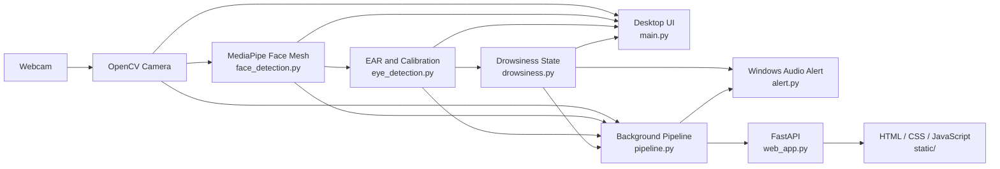
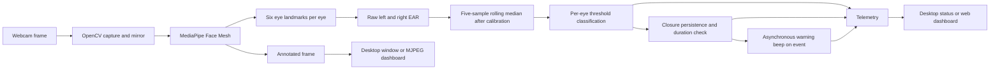

# Driver Drowsiness Detection (DDD)

## Project overview

Driver Drowsiness Detection is a Windows webcam demonstration that estimates
eye openness from facial landmarks and raises an audio warning when both eyes
remain classified as closed for the configured duration. It provides a desktop
OpenCV application and a browser dashboard backed by FastAPI.

### Objectives

- Detect one visible face and obtain facial landmarks from webcam frames.
- Calculate a separate Eye Aspect Ratio (EAR) measurement for each eye.
- Calibrate per-eye thresholds, smooth measurements, and classify eyes as
  open or closed.
- Detect sustained bilateral eye closure and issue a short warning beep.
- Present video and runtime telemetry in a desktop window or web dashboard.

This is an academic demonstration, not a validated driver-safety system. It has
not been validated for real-world driving and must not be relied on to prevent
drowsiness-related incidents.

## Technology stack

- Python 3.10 (the existing virtual environment configuration records 3.10.0)
- OpenCV with contrib modules for camera capture, frame processing, and display
- MediaPipe Face Mesh for facial landmarks
- NumPy for landmark geometry and EAR calculations
- FastAPI and Uvicorn for the web API and dashboard server
- HTML, CSS, and JavaScript for the responsive browser dashboard
- Python `unittest` for automated tests

The pinned packages in `requirements.txt` are MediaPipe 0.10.21,
`opencv-contrib-python` 4.11.0.86, NumPy 1.26.4, FastAPI 0.143.0, and
Uvicorn 0.54.0. The FastAPI and Uvicorn pins were verified in the existing
Python 3.10 environment; the web application imports successfully there.

## Architecture



`main.py` runs the desktop loop. The web application uses `pipeline.py` to
capture and process frames in a background worker; `web_app.py` exposes
telemetry and an MJPEG stream. Both paths use the same camera, face detection,
eye detection, drowsiness, and alert modules. The desktop path displays an
OpenCV window; the web path serves the dashboard and API.

## Processing workflow



### EAR, calibration, and classification

For six eye landmarks, the implementation calculates:

`EAR = (distance(p2, p6) + distance(p3, p5)) / (2 * distance(p1, p4))`

The points are the configured six-point eye subsets in `eye_detection.py`.
Coordinates are scaled by the frame width and height before distances are
calculated. Invalid or degenerate landmarks produce an unavailable
measurement.

Calibration runs for five seconds and collects valid EAR samples separately
for each eye while a face is available. Each eye needs at least 30 valid
samples. When enough samples are available, its baseline is the median of its
calibration samples and its threshold is 75% of that baseline. An eye without
enough samples uses the configured fallback threshold of 0.21; the status
reports which eye used fallback. The baseline is unavailable for an eye using
fallback.

After calibration, each eye's recent raw EAR values are kept in a rolling
window of five. The median is the smoothed EAR used for classification. A
smoothed EAR strictly below that eye's threshold is `CLOSED`; a value equal to
or above the threshold is `OPEN`. Missing face or eye measurements are
reported as unavailable rather than closed. During calibration, the current
raw EAR can be displayed before a smoothed value is available.

The drowsiness detector requires calibration to have completed and both valid
eye measurements to be classified closed. A 0.2-second persistence interval
filters brief closure classifications. The closure timer starts with the
first closed reading, and the detector triggers when that continuous duration
reaches two seconds. A missing face/measurement or an open eye resets the
closure state. On a newly triggered event, the Windows alert attempts one
1,000 Hz, 600 ms beep asynchronously. It does not repeat during the same
continuous event; reopening rearms it for a later event.

Relevant values are defined in `config.py`: camera index 0, one detected face,
and MediaPipe detection/tracking confidence values of 0.5.

## Environment setup

Python 3.10.0 has been verified in the user's PowerShell terminal and matches
the version recorded in `.venv\pyvenv.cfg`. Reuse the existing environment
when its interpreter works; do not recreate it unnecessarily. From the
project directory, check the installed Python and required imports:

```powershell
py -3.10 --version
```

Use the existing environment to check its version and core packages:

```powershell
.\.venv\Scripts\python.exe --version
.\.venv\Scripts\python.exe -c "import cv2, mediapipe, numpy; print(cv2.__version__, mediapipe.__version__, numpy.__version__)"
```

Install the pinned core dependencies from the project directory only if they
are missing from the working environment:

```powershell
.\.venv\Scripts\python.exe -m pip install -r requirements.txt
```

Confirm that FastAPI and Uvicorn imports work before launching the web app:

```powershell
.\.venv\Scripts\python.exe -c "import fastapi, uvicorn; print(fastapi.__version__, uvicorn.__version__)"
```

The `.venv\pyvenv.cfg` file records the base Python installation path used to
create the environment. That path is machine-specific; use `py -3.10 --version`
to check the registered Python 3.10 interpreter on a Windows machine.

## Run the desktop application

From an interactive Windows desktop, run:

```powershell
.\.venv\Scripts\python.exe main.py
```

The application opens camera index 0. During the five-second startup
calibration, face the camera, keep both eyes comfortably open, and keep the
head neutral. Press **Q** while the OpenCV window is focused to exit. The app
closes its detector, releases the camera, waits for any active short beep, and
destroys its OpenCV windows during cleanup.

## Run the web application

From the project directory, with the existing environment's FastAPI and
Uvicorn imports available:

```powershell
.\.venv\Scripts\python.exe web_app.py
```

The server binds to `127.0.0.1:8000`. Open the dashboard at
<http://127.0.0.1:8000/>. Monitoring is started with **Start Monitoring**;
**Stop Monitoring** releases the webcam, and **Recalibrate** begins a fresh
calibration while monitoring is active. The dashboard presents the MJPEG
camera feed, monitoring/camera/face states, raw and smoothed eye EAR,
thresholds and classifications, calibration progress and sample counts,
drowsiness state, and diagnostic/runtime messages where telemetry is
available.

### API endpoints

| Method | Path | Purpose |
| --- | --- | --- |
| `GET` | `/api/health` | Reports that the API service is responding. |
| `GET` | `/api/status` | Returns the current pipeline telemetry, including monitoring and camera state, face/landmark availability, per-eye measurements and thresholds, calibration data, drowsiness state, alert-event state, and errors where available. |
| `GET` | `/video_feed` | Streams annotated frames as `multipart/x-mixed-replace` MJPEG. |
| `POST` | `/api/start` | Starts a new monitoring session; returns a JSON status and message. |
| `POST` | `/api/stop` | Stops monitoring and releases resources; returns a JSON status and message. |
| `POST` | `/api/recalibrate` | Resets calibration while monitoring is running; returns a JSON status and message. |

An armed or active alert event in telemetry indicates the detector's event
state; it does not confirm that speakers are connected or that sound was
audible.

## Automated tests

Run the suite from the project directory with:

```powershell
.\.venv\Scripts\python.exe -m unittest discover -s tests -v
```

The latest result reported for this project was **81 tests passing**. This is
the previously reported result and was not rerun while preparing this README.
The tests cover EAR and calibration, drowsiness state transitions, alert
behavior, mocked camera behavior, pipeline lifecycle and telemetry, and web
API/dashboard integration. Hardware-dependent camera and audio behavior is
not validated by the automated suite.

## Troubleshooting

- **The virtual environment cannot start:** Check that `py -3.10 --version`
  works and compare `.venv\pyvenv.cfg` with the installed Python path. Reuse
  a working compatible Python installation and environment where possible;
  Python 3.10.0 is verified for this project. Do not rebuild `.venv`
  unnecessarily.
- **Imports fail:** Confirm the environment's Python executable and inspect
  the package imports. Install the pinned requirements only if needed.
- **Camera unavailable or already in use:** Connect a webcam, allow Windows
  camera access, close other applications using it, and verify camera index 0
  is the intended device.
- **No face or unstable measurements:** Improve lighting, keep the face and
  both eyes visible, and face the camera during calibration. Head turns,
  downward gaze, occlusion, camera perspective, and unstable landmarks can
  affect 2D EAR measurements.
- **Calibration uses fallback:** Keep both eyes comfortably open and the
  face visible through the five-second period so each eye can collect at
  least 30 valid samples. Recalibrate after correcting the camera view.
- **Dashboard does not load:** Confirm the server started successfully and
  open <http://127.0.0.1:8000/>. Check that FastAPI and Uvicorn imports work
  in the selected environment.
- **No audible warning:** Check Windows output selection and volume. The
  application uses `winsound.Beep`; automated tests do not verify speaker
  output.

## Limitations

- The project uses 2D landmark distances and does not estimate or compensate
  for head pose. Accuracy can vary with head turns, downward gaze, lighting,
  occlusion, camera placement, and landmark quality.
- Webcam and audible-alert behavior depends on the host machine and requires
  physical testing. The automated tests use mocked hardware.
- The system has not been validated under real driving conditions and is not
  a substitute for rest, safe driving practices, or a certified safety system.
